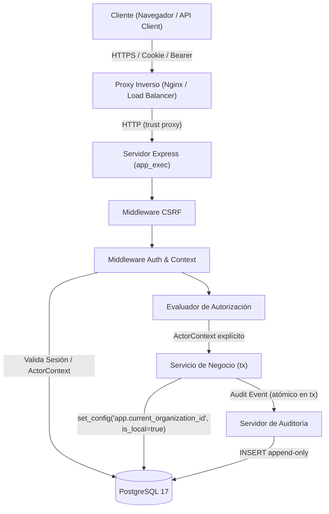

# Security Guidelines

## 1. Objetivo

Establecer requisitos mínimos de seguridad para el generador y los proyectos que produce.

La seguridad debe formar parte del diseño y de las pruebas, no añadirse como una corrección posterior.

Los requisitos concretos dependen de las capacidades seleccionadas, el tipo de aplicación y sus riesgos.

## 2. Principios generales

- Aplicar el principio de mínimo privilegio.
- Denegar el acceso por defecto cuando exista un mecanismo de autorización.
- Validar y tratar como no confiables los datos recibidos del exterior.
- Aplicar controles de seguridad en el servidor.
- No confiar en las restricciones implementadas únicamente en el frontend.
- Evitar exponer secretos o información interna.
- Mantener las dependencias actualizadas y evaluar sus riesgos.
- Probar los controles de seguridad y sus casos negativos.
- No declarar una funcionalidad segura sin haber verificado los controles relevantes.

## 3. Autenticación

Si se selecciona autenticación, la implementación debe incluir un flujo funcional, documentado y probado contra casos positivos y negativos.

### Mecanismo y credenciales (D-087, D-100)

- **Identidad interna exclusiva (D-100):** Auth v1 opera únicamente con el proveedor de identidad interno de Brixa. Quedan fuera de alcance OAuth, OIDC, SSO y proveedores externos.
- **Sesiones opacas con token de 32 bytes (D-087):** Único modelo en v1, sin JWT. Generado con `crypto.randomBytes(32)` o Web Crypto API. En base de datos se almacena **exclusivamente el hash SHA-256** del token; el token en claro nunca se persiste.
- **Autoridad server-side:** PostgreSQL es la autoridad sobre la validez de la sesión; cada petición verifica vigencia y revocación.
- **Transportes de autenticación (D-089):** Fullstack utiliza **exclusivamente cookies** de sesión. Backend independiente permite seleccionar entre cookies o Bearer (sin mezcla simultánea). En Bearer se utiliza la cabecera estándar `Authorization: Bearer <token>`.

### Ciclo de vida y expiración de sesiones (D-088, D-101)

- **Doble control temporal:**
  - **Inactividad máxima deslizante:** 30 minutos por defecto (`SESSION_IDLE_TIMEOUT_MINUTES`).
  - **Límite absoluto e improrrogable:** 12 horas desde la creación de la sesión (`SESSION_MAX_LIFETIME_HOURS`). Ninguna petición puede extender la sesión más allá de este límite.
- **Actualización diferida de actividad:** Umbral de **60 segundos** entre escrituras persistidas en la BD (`last_activity_at`) para evitar contención de filas ante peticiones concurrentes.
- **Garantías de expiración:** El mecanismo de actualización diferida mantiene la vigencia estricta de las sesiones; la actualización diferida nunca extiende la sesión más allá de `created_at + max_lifetime`.
- **Exclusión de tráfico de mantenimiento:** Consultas automatizadas (pings, polling de frontend o sondeos de salud `/health`) no prolongan la sesión; solo actividad intencionada de usuario actualiza la marca.
- **Sin rotación periódica en v1:** No hay rotación automática periódica durante peticiones normales. La rotación del identificador de sesión se restringe estrictamente a eventos de seguridad (cambio de contraseña, elevación de privilegios).
- **Revocación inmediata:** La revocación de la sesión en base de datos impide el acceso en la petición inmediatamente posterior.

### Cookies de sesión y desarrollo local (D-089, D-099)

- **Producción:** HTTPS y cookies `Secure` obligatorias. Cualquier configuración que intente emitir cookies sin `Secure` en producción o staging debe fallar de forma temprana en el arranque con error descriptivo.
- **Desarrollo HTTP local:** Excepción acotada a `NODE_ENV === 'development'` en `localhost` / `127.0.0.1` para desarrollo sin HTTPS, emitiendo un aviso visible en consola al iniciar.
- **Propiedades inmutables:** `HttpOnly`, `SameSite=Lax`, `Path=/`, sin atributo `Domain` y con un nombre de cookie específico por proyecto para evitar colisiones entre proyectos locales en `localhost`.
- **Prefijo `__Host-`:** Exigido únicamente cuando se cumplen de forma acumulativa sus tres requisitos formales (conexión HTTPS con `Secure`, `Path=/` y sin `Domain`). En desarrollo HTTP local no se emite para evitar rechazos por el navegador.
- **Terminación TLS por proxy:** Configuración explícita de `trust proxy` en Express para determinar el protocolo seguro tras balanceadores o proxies inversos confiables.

### Hash de contraseñas con Argon2id (D-091, D-092, D-093, D-102)

- **Algoritmo y biblioteca:** Argon2id versión 19 (`v=19`) mediante `@node-rs/argon2` versión `2.2.2`.
- **Parámetros operativos base (D-092):** Memoria $m = 19456\text{ KiB}$ (19 MiB), iteraciones $t = 2$, paralelismo $p = 1$, salida de 32 bytes y salt aleatorio de 16 bytes. Formato PHC canónico codificado en Base64 convencional sin padding.
- **Límites defensivos en verificación previa (D-102):** Antes de ejecutar `verify()`, se parsea y valida defensivamente el string PHC:
  - Longitud máxima del string PHC: 512 bytes.
  - Rango de memoria ($m$): $19456\text{ KiB}$ a $65536\text{ KiB}$ (19 a 64 MiB).
  - Rango de tiempo ($t$): 2 a 4 pasadas.
  - Rango de paralelismo ($p$): 1 a 2 hilos.
  - Longitud de salt: 16 a 32 bytes; hash: exactamente 32 bytes.
  - Parámetros fuera de rango o sintaxis corrupta: rechazo inmediato **sin invocar Argon2id**, registrando un aviso técnico sin exponer secretos.
- **Limitador de concurrencia operativo (D-102):** Máximo 2 operaciones Argon2id concurrentes por proceso y cola de espera de máximo 8 solicitudes. Saturación (>8 en cola) rechaza inmediatamente con **HTTP 503** y `Retry-After: 5`. Aplica a `hash()`, `verify()` y al cálculo de verificación simulada (*dummy hash*).
- **Mitigación de enumeración por temporización:** Cuando una cuenta no existe en el inicio de sesión, el backend ejecuta una verificación simulada con un hash Argon2id dummy preparado en memoria para igualar los tiempos de respuesta.
- **Rehash transparente:** Se ejecuta exclusivamente tras una autenticación exitosa si los parámetros almacenados difieren de los vigentes pero están dentro de los límites defensivos permitidos.
- **Entrada acotada:** Contraseñas entrantes limitadas a un máximo de 128 caracteres y 512 bytes UTF-8 (D-093).

### Aprovisionamiento administrado y activación de cuentas (D-085, D-086, D-107)

- **Aprovisionamiento administrado por defecto:** El modelo estándar es administrado por un actor con permisos. Si el usuario ya existe en el sistema, se reutiliza su identidad global. No se genera un sistema de invitaciones con aceptación voluntaria en v1.
- **Activación segura de cuentas creadas administrativamente (D-107):**
  - Cuentas nuevas quedan en estado `pending_activation`.
  - Token de activación de 32 bytes aleatorios criptográficos, caducidad limitada y de un solo uso.
  - En la base de datos se almacena **exclusivamente el hash SHA-256** del token; el token en claro nunca se persiste.
  - El enlace se entrega de forma controlada al administrador para su distribución por canal privado seguro (sin SMTP obligatorio en el núcleo).
  - El enlace permite únicamente establecer la contraseña inicial; no otorga sesión ni acceso a datos de negocio.
  - Consumo atómico: validación del token, hash de la contraseña con Argon2id y consumo del token dentro de una misma transacción.
  - El administrador puede invalidar un enlace pendiente y generar uno nuevo sin destruir la cuenta.
  - Prohibido registrar tokens de activación en claro en logs, auditorías o respuestas de error.
- **Registro público condicionado (D-086):** Configurable en CLI exclusivamente para proyectos con Auth sin multitenancy (manteniendo registro administrado como predeterminado). No otorga privilegios administrativos bajo ningún concepto, incorpora rate limiting estricto y no permite la creación pública de organizaciones.
- **Bootstrap seguro del primer administrador (D-085):** Comando de consola local del proyecto generado. Idempotente, resistente a condiciones de carrera, sin contraseñas de fábrica y sin endpoints HTTP públicos.

## 4. Autorización y RBAC

Si se selecciona RBAC, el sistema debe distinguir entre autenticación y autorización.

Estar autenticado no implica tener permiso para realizar cualquier operación.

### Catálogo de permisos

Los módulos declaran los permisos que necesitan en el código fuente.

El sistema debe definirlos de forma declarativa en el código y sincronizarlos con la base de datos (D-082).

Registrar un permiso en el catálogo no protege automáticamente una ruta ni una operación. Los administradores no pueden definir permisos arbitrarios desde la interfaz o la API sin respaldo en el código.

### Aplicación efectiva de permisos y propagación de contexto

Cada ruta, controlador o caso de uso protegido debe aplicar explícitamente el control de autorización correspondiente.

La implementación debe verificar el permiso requerido antes de ejecutar la operación protegida.

El contexto del actor (`ActorContext`) debe propagarse de forma estrictamente explícita como argumento en servicios, casos de uso, repositorios y transacciones (D-080). Queda descartado el uso de `AsyncLocalStorage` (ALS) para comprobaciones de autorización o decisiones de aislamiento.

Los controles no deben depender exclusivamente de que el frontend oculte botones o páginas.

### Roles y permisos dinámicos (D-082)

Los roles agrupan permisos conocidos del catálogo y pueden crearse, editarse y asignarse dinámicamente desde el panel o la API administrativa (D-082).

Los alcances de autorización admitidos en esta etapa son exclusivamente de **aplicación** (sistema) y de **organización** (D-082). Se descarta la implementación de motores genéricos ABAC o ReBAC.

La asignación de permisos debe validar que los permisos existen en el catálogo y que quien realiza la asignación está autorizado para hacerlo.

No se deben aceptar permisos arbitrarios enviados por el cliente.

### Delegación administrativa y salvaguardas de RBAC (D-106)

- **Autorización explícita:** Toda acción administrativa (crear usuarios, asignar roles, revocar accesos) exige permisos específicos en el catálogo.
- **Principio de autoridad delegable:** Tener un permiso no implica la facultad de delegarlo. Asignar roles/permisos exige explícitamente autoridad de delegación y se acota a un subconjunto estricto de los permisos efectivos del actor. Nadie puede conceder privilegios superiores a los que posee.
- **Verificación de permisos efectivos:** La autorización comprueba los permisos efectivos resueltos, nunca comparaciones literales de nombres de roles (`role.name === 'ADMIN'`).
- **Prohibición de automodificación:** Un actor no puede alterar directamente sus propios roles, permisos ni concesiones de acceso, impidiendo auto-escaladas o degradaciones no autorizadas.
- **Protección del último administrador efectivo:** En cada ámbito (plataforma o tenant con RBAC), siempre debe existir al menos un administrador activo. Cualquier intento de revocación o degradación que deje al ámbito sin administrador es rechazado de forma atómica bajo una transacción con bloqueo concurrente pesimista (`SELECT FOR UPDATE`).
- **No abandono voluntario de organizaciones:** Los usuarios no pueden abandonar unilateralmente una organización ni autorrevocar sus concesiones; el acceso se administra exclusivamente por actores autorizados. Brixa no genera endpoints ni UI de autoservicio para abandonar organizaciones.
- **Trazabilidad obligatoria:** Toda modificación o revocación administrativa se registra atómicamente en la auditoría correspondiente (D-105).

### Extensibilidad modular

Las capacidades Auth, RBAC y multitenancy deben permitir incorporar módulos de negocio, permisos nuevos y validaciones adicionales sin modificar sus mecanismos internos ni la lógica del núcleo de seguridad.

### Alcance sobre recursos

Tener un permiso general no implica necesariamente acceso a todos los recursos.

Cuando corresponda, deben aplicarse restricciones adicionales, como:

- Acceso únicamente a recursos propios.
- Acceso limitado a una organización.
- Acceso limitado a una sucursal.
- Acceso limitado a determinados estados o relaciones del recurso.

Estas restricciones deben verificarse en el servidor y aplicarse también a consultas y modificaciones de datos.

## 5. Multitenancy y aislamiento de datos

Si se selecciona multitenancy, el aislamiento entre organizaciones es un requisito crítico.

### Obligatoriedad de PostgreSQL RLS y exclusión de SQLite (D-064, D-094)

El aislamiento a nivel de base de datos mediante Row-Level Security (RLS) en PostgreSQL es obligatorio para todas las variantes con multitenancy. SQLite queda terminantemente excluido de multitenancy en esta etapa.

### Roles, privilegios y separación de credenciales (D-094)

- **Separación estricta de identidades:** se separan la identidad de ejecución de la aplicación (`app_exec`) y la identidad de migraciones y gestión de esquema (`table_owner`).
- **Restricciones del rol de ejecución (`app_exec`):** no puede ser superusuario ni poseer el atributo `BYPASSRLS`; no puede ser propietario de tablas protegidas por RLS; no posee privilegios de DDL ni `TRUNCATE` sobre tablas protegidas; y opera con privilegios DML mínimos (`SELECT`, `INSERT`, `UPDATE`, `DELETE`).
- **Credenciales separadas:** el servicio de aplicación Express utiliza `DATABASE_URL` (con rol `app_exec`) y las herramientas de migración Drizzle utilizan `MIGRATION_DATABASE_URL` (con rol `table_owner`).
- **Aprovisionamiento administrado:** se documenta y proporciona aprovisionamiento claro para proveedores de PostgreSQL administrados (RDS, Cloud SQL, Neon, Supabase, etc.).
- **Fallo explícito ante privilegios inadecuados:** si en el arranque o verificación no se garantizan las restricciones requeridas para `app_exec`, el sistema debe fallar explícitamente. Queda prohibido desactivar RLS como solución o degradación permisiva.

### Migraciones PostgreSQL RLS (D-104)

- **Drizzle Schema como fuente del modelo:** Tablas, relaciones e índices se definen en TypeScript mediante el esquema Drizzle.
- **Migraciones SQL versionadas y reproducibles:** Las sentencias de seguridad que escapan a Drizzle (`ENABLE ROW LEVEL SECURITY`, `FORCE ROW LEVEL SECURITY`, `CREATE POLICY`, `GRANT`, `REVOKE`) se implementan como archivos SQL personalizados versionados en `drizzle/` y se ejecutan ordenadamente con `npm run db:migrate`.
- **Ejecución con rol propietario:** Las migraciones se ejecutan exclusivamente con el rol `table_owner` (`MIGRATION_DATABASE_URL`).
- **Aprovisionamiento externo:** La creación de roles en PostgreSQL se gestiona como infraestructura previa; las migraciones asumen la existencia de los roles y solo gestionan privilegios sobre sus tablas.
- **Regla inquebrantable:** Nunca desactivar RLS para resolver fallos de migración o configuración.

### Contexto organizacional y transacciones (D-080, D-095)

- **Determinación y validación:** la organización activa se selecciona explícitamente por petición y se valida obligatoriamente contra la base de datos en cada solicitud, comprobando la existencia de una concesión de acceso vigente (D-080). Queda prohibido confiar en identificadores provistos por el cliente.
- **Contexto local por transacción:** el contexto en PostgreSQL se establece exclusivamente mediante `SELECT set_config('app.current_organization_id', ?, true)` con `is_local = true`, parámetros enlazados y transacciones de Drizzle ORM (`db.transaction`).
- **Obligatoriedad transaccional en lecturas y mutaciones (B-8):** En modo autocommit fuera de una transacción explícita, `set_config` con `is_local=true` finaliza inmediatamente al completarse la sentencia y no permanece disponible para operaciones posteriores, provocando denegación por defecto (cero filas). Por tanto, **todas las operaciones sobre entidades organizacionales (incluidas lecturas `SELECT` y endpoints `GET`) deben ejecutarse dentro de una transacción explícita autorizada**.
- **Una organización por transacción:** cada transacción organizacional corresponde estrictamente a una única organización.
- **Propagación explícita:** los servicios organizacionales reciben explícitamente el objeto transaccional autorizado (`tx`). Se descarta `AsyncLocalStorage` (ALS) para transmitir autorización o aislamiento.
- **Denegación por defecto:** ante la ausencia o vacío de contexto organizacional, las políticas RLS deniegan el acceso devolviendo cero filas.
- **Separación de operaciones:** las operaciones globales (identidad, autenticación, validación de concesiones) se ejecutan sin contexto organizacional; las operaciones de tenant operan en transacciones con contexto fijado.
- **Agregaciones legítimas multiorganización:** agregaciones que requieran datos de múltiples organizaciones para un actor autorizado se realizan mediante consultas independientes y autorizadas por organización; sin bypass general de RLS.
- **Compatibilidad con pooling por transacción:** compatible con transaction pooling (como PgBouncer); al finalizar la transacción (`COMMIT` o `ROLLBACK`), PostgreSQL limpia automáticamente la variable GUC local, impidiendo contaminación entre clientes en conexiones reutilizadas.
- **Limitación documentada:** la ejecución de SQL arbitrario puede alterar el GUC (`set_config`). RLS actúa como defensa en profundidad contra filtros olvidados; **RLS no sustituye la prevención de inyección SQL**.

### Políticas de aislamiento e integridad relacional (D-096)

- **Clasificación de tablas:** clasificación explícita entre tablas globales y tablas organizacionales.
- **Protección de tablas organizacionales:** columna `organization_id` obligatoria, con RLS habilitado y forzado mediante `FORCE ROW LEVEL SECURITY`.
- **Políticas de lectura y escritura:**
  - Lectura (`SELECT`): `USING (organization_id = NULLIF(current_setting('app.current_organization_id', true), '')::uuid)`.
  - Escritura (`INSERT`, `UPDATE`): `WITH CHECK (organization_id = NULLIF(current_setting('app.current_organization_id', true), '')::uuid)`.
  - Barrera restrictiva combinada con políticas permisivas; prohibición expresa de políticas permisivas abiertas (`USING (true)`) en tablas organizacionales.
- **Manejo seguro de contexto ausente/vacío:** la expresión `NULLIF(..., '')::uuid` asegura evaluación a `NULL` ante variable ausente o vacía, denegando el acceso.
- **Claves primarias simples:** se mantienen claves primarias simples por defecto (`id uuid PRIMARY KEY`), sin imponer PK compuestas universales.
- **Integridad referencial (FK):** claves foráneas estándar para garantizar integridad relacional. En relaciones entre entidades organizacionales que deban permanecer aisladas, claves foráneas compuestas con `organization_id` (`FOREIGN KEY (organization_id, parent_id) REFERENCES parent_table(organization_id, id)`). Diseños sin FK física solo admisibles con garantías alternativas explícitas y verificables.
- **Restricciones UNIQUE:** alcance por organización (`UNIQUE (organization_id, ...)`).
- **Operaciones especiales restringidas:** prohibición de permiso `TRUNCATE` para `app_exec`; `COPY FROM` no admitido con RLS; vistas obligatoriamente con `WITH (security_invoker = true)`; funciones `SECURITY DEFINER` restringidas y con `search_path` explícito y seguro.
- **Separación de capas:** la autorización efectiva y las comprobaciones RBAC permanecen en Express; RLS garantiza aislamiento de filas en datos. Consultas SQL parametrizadas en Drizzle.
- **Extensibilidad modular:** los nuevos módulos de negocio deben poder incorporar entidades organizacionales registrando sus tablas y políticas bajo este patrón, sin necesidad de reescribir Auth ni desactivar RLS.

### Independencia de RBAC

Multitenancy es completamente independiente de RBAC (D-064, D-083). Cuando multitenancy opera sin RBAC, existen organizaciones y concesiones de acceso organizacionales para vincular al usuario con la organización, pero NO se crean roles fijos `owner/member`. La autorización básica consiste en verificar la existencia de una concesión de acceso válida y vigente.

### Ciclo de vida de concesiones de acceso

Las concesiones de acceso entre usuarios y organizaciones se gobiernan mediante una marca temporal `revoked_at` (D-081). La revocación es definitiva; una reconcesión posterior genera una nueva fila independiente sin heredar roles previos. En PostgreSQL se debe aplicar un índice de unicidad parcial para concesiones vigentes (`WHERE revoked_at IS NULL`). Queda descartado el uso de campos booleanos universales `isActive`.

### Separación estricta de administración de plataforma

La administración de plataforma está estrictamente separada de la administración organizacional (D-084). Los administradores de plataforma operan a nivel de sistema y no poseen acceso global automático a los datos de negocio de las organizaciones ni cuentan con bypass genérico de Row-Level Security (RLS). Para operar sobre datos internos de una organización, requieren una concesión de acceso explícita y vigente en dicha organización.

### Operaciones bajo aislamiento

Todas las operaciones relevantes deben respetar el contexto de la organización, incluidas:

- Lecturas individuales y listados.
- Creación de recursos.
- Actualizaciones y eliminaciones.
- Relaciones entre entidades.
- Consultas agregadas.
- Operaciones en segundo plano.
- Exportaciones y reportes.
- Acciones administrativas, cuando correspondan.

Las modificaciones deben verificar que el recurso pertenece al ámbito autorizado antes de ejecutarse.

La validación de identificadores aislada no sustituye el control de autorización.

Las relaciones entre entidades también deben respetar el mismo ámbito. No debe ser posible asociar un recurso de una organización con otro recurso perteneciente a una organización diferente, salvo que exista una regla explícita y segura que lo permita.

## 6. Validación de entradas

Los datos externos deben validarse en los límites del sistema.

La validación debe comprobar el tipo, formato, longitud, rango y restricciones pertinentes.

Las operaciones de escritura deben validar los campos permitidos y evitar asignaciones masivas de propiedades no autorizadas.

La validación de datos no sustituye la autorización.

Las consultas a bases de datos deben utilizar mecanismos seguros de parametrización o las protecciones equivalentes de la biblioteca utilizada.

No se deben construir consultas mediante concatenación insegura de datos externos.

## 7. Protección de sesiones y solicitudes

Cuando la aplicación utilice autenticación basada en cookies o exponga endpoints mutables, se aplican los siguientes controles obligatorios:

### Protección CSRF multicapa para transporte por cookies (D-089, D-103)

- **Middleware centralizado:** Middleware de seguridad CSRF en Express aplicado a todas las peticiones con métodos mutables (`POST`, `PUT`, `PATCH`, `DELETE`) en rutas que utilicen autenticación mediante cookies.
- **Validación estricta de origen:** Verificación obligatoria de `Origin` (o `Referer` como respaldo) contra la lista de orígenes autorizados (`CORS_ALLOWED_ORIGINS` y host propio). Ausencia o discrepancia de origen deniega inmediatamente con **HTTP 403 (Forbidden)**.
- **Fetch Metadata complementario:** Comprobación de cabeceras `Sec-Fetch-Site: same-origin` / `same-site` y `Sec-Fetch-Mode` como defensa en profundidad.
- **Cabecera personalizada obligatoria en mutaciones de API:** Exigencia de cabecera personalizada (p. ej. `X-Requested-With: XMLHttpRequest`) en peticiones AJAX/fetch mutables, bloqueando envíos inducidos por elementos HTML estándar sin preflight CORS.
- **CORS restrictivo (D-074):** Orígenes explícitos sin comodines (`*`) ni valor `null`.
- **Topología fullstack same-origin sin sincronizador:** Dado que el frontend y el backend comparten origen (vía Nginx en Docker o proxy Vite en local), la combinación de cookies con `SameSite=Lax`, validación estricta de `Origin`, Fetch Metadata y cabecera personalizada proporciona protección completa sin sobrecargar la aplicación con sincronizadores de tokens en memoria o sesión.
- **Protección de endpoints de sesión:** El inicio de sesión (`/login`), cierre de sesión (`/logout`) y activación de cuentas están estrictamente protegidos contra ataques de login/logout CSRF.
- **Idempotencia de métodos seguros:** Se garantiza contractualmente que los métodos `GET` y `HEAD` son de solo lectura y nunca producen alteraciones de estado de negocio.
- **CSRF no sustituye la defensa contra XSS:** La protección CSRF presupone que el origen confiable no está comprometido; las defensas XSS (CSP estricta, escape de datos y cookies `HttpOnly`) son obligatorias e independientes.

## 8. Secretos y configuración

Los secretos no deben aparecer en:

- El código fuente.
- Los archivos de ejemplo del entorno.
- Los registros.
- Los mensajes de error.
- Las respuestas de la API.
- Los repositorios públicos.

Los archivos `.env` con valores reales deben excluirse del control de versiones cuando corresponda.

Los archivos `.env.example` deben contener nombres de variables y valores ilustrativos no sensibles.

La configuración debe validarse al iniciar la aplicación.

## 9. Errores, registros y auditoría (D-097, D-105)

Los mensajes de error públicos deben ser útiles sin exponer detalles internos (D-071).

Las trazas completas y los detalles técnicos pueden registrarse de forma controlada en el servidor, aplicando redacción centralizada de credenciales y secretos (D-073, D-076).

Los registros deben evitar almacenar contraseñas, tokens de autenticación u otras credenciales.

La información personal debe tratarse con criterios de minimización y protección adecuados al contexto.

### Auditoría en dos ámbitos: global/sistema y organizacional (D-097, D-105)

1. **Auditoría global o de sistema (`audit_log_system`):**
   - **Alcance:** Eventos de autenticación (login, logout, fallos repetidos, activación de cuentas, cambios de credenciales), operaciones administrativas globales (usuarios de plataforma, aprovisionamiento de tenants, bootstrap inicial) e intentos no autorizados de acceso organizacional.
   - **Acceso:** Restringido a administradores y operadores con alcance de sistema. No requiere columna `organization_id`.
2. **Auditoría organizacional (`audit_log_org`):**
   - **Alcance:** Mutaciones críticas dentro del tenant (cambios de configuración, asignación/revocación de roles RBAC a concesiones, altas/bajas de concesiones de acceso, eventos de negocio críticos).
   - **Protección RLS obligatoria:** Columna `organization_id` no nula y políticas RLS forzadas (`FORCE ROW LEVEL SECURITY`), garantizando aislamiento estricto de registros entre organizaciones.
   - **Acceso:** Administradores autorizados de la propia organización.
3. **Garantías comunes de inmutabilidad y persistencia:**
   - **Historial append-only:** Tablas de solo inserción. El rol `app_exec` carece contractualmente de permisos `UPDATE` y `DELETE` sobre las tablas de auditoría.
   - **Atomicidad transaccional:** Las mutaciones de negocio y su evento de auditoría se persisten atómicamente dentro de la misma transacción de base de datos (`tx`).
   - **Persistencia de denegaciones fuera de rollback:** Los intentos de acceso denegados, anomalías y violaciones de seguridad se registran **fuera de las transacciones revertidas** (vía conexión o transacción independiente de auditoría) para evitar que un atacante borre su rastro forzando un error.
   - **Correlación de peticiones:** Inclusión obligatoria del identificador `requestId` en cada registro para trazabilidad de extremo a extremo.
   - **Proyectos sin multitenancy:** La auditoría opera únicamente en el ámbito global (`audit_log_system`) sin generar infraestructura de tablas ni políticas RLS organizacionales.
   - **Limitación documentada:** La inmutabilidad relacional protege a nivel de aplicación; no se promete inmutabilidad absoluta frente a superusuarios del motor de base de datos PostgreSQL. En v1 no se incluye panel visual empresarial de auditoría ni integración SIEM obligatoria.

## 10. Dependencias y cadena de suministro

Las dependencias deben elegirse considerando su mantenimiento, reputación, licencia y necesidad real.

Se deben evitar paquetes innecesarios.

El proyecto debe permitir revisar las dependencias y detectar vulnerabilidades mediante herramientas apropiadas.

No se debe considerar que una dependencia es segura únicamente porque es popular.

Los cambios de dependencias deben evaluarse y verificarse con las pruebas disponibles.

## 11. Pruebas y verificación de seguridad (D-097)

Cuando existan controles de autenticación, autorización o multitenancy, las pruebas deben cubrir tanto el acceso permitido como el denegado.

### Auditoría estructural de RLS (D-097)

- **Verificaciones automáticas:** comprobación automática de roles, privilegios de PostgreSQL, tablas protegidas, políticas activas, restricciones de integridad y aislamiento.
- **Inspección de catálogo:** inspección programática de catálogos del sistema PostgreSQL (`pg_tables`, `pg_roles`, `pg_policies`, etc.) combinada con pruebas funcionales reales sobre conexiones de prueba.
- **Detección de vulnerabilidades:** detección de tablas organizacionales sin protección o con políticas permisivas (`USING (true)`) que comprometan el aislamiento.
- **Bloqueo de CI:** las verificaciones estructurales críticas fallidas bloquean la integración continua.
- **Paridad funcional:** garantías equivalentes en variantes JavaScript y TypeScript.
- **Integración futura:** integración en el sistema de verificación de seguridad previsto (`verify:security`, T-018).
- **Separación de entornos:** las comprobaciones estructurales pesadas de catálogo no deben ejecutarse en cada petición HTTP en producción.

### Evaluación de rendimiento de RLS (D-097)

- **Entorno aislado:** benchmarks representativos con y sin RLS ejecutados exclusivamente en laboratorios de prueba aislados.
- **Comparación formal:** comparar consultas equivalentes con filtros organizacionales e índices adecuados en `organization_id`.
- **Métricas obligatorias:** análisis de planes de ejecución mediante `EXPLAIN (ANALYZE, BUFFERS)` para descartar escaneos secuenciales innecesarios, latencias p50/p95 y consumo de memoria/CPU.
- **Documentación:** documentar degradaciones observadas y optimizaciones de índices recomendadas.
- **Prohibición:** no ofrecer una variante pública multitenant sin RLS.

### Casos de prueba negativos críticos:

- Usuario no autenticado intenta acceder a un recurso protegido (401).
- Usuario autenticado carece del permiso requerido (403).
- Usuario intenta acceder a un recurso ajeno (IDOR mitigado).
- Usuario de una organización intenta acceder a datos de otra (cero filas por RLS).
- Usuario intenta modificar el identificador de organización en peticiones.
- Usuario intenta asociar entidades de organizaciones diferentes (violación de FK compuesta rechazada por BD).
- Usuario intenta asignar permisos que no posee o no puede delegar (rechazo por regla de autoridad delegable D-106).
- Usuario intenta modificar directamente sus propios roles, permisos o concesiones (rechazo D-106).
- Intento concurrente de revocación o degradación del último administrador de un ámbito (rechazo y preservación de la invariante D-106).
- Usuario intenta abandonar voluntariamente una organización por autoservicio (operación no disponible / 404/403 D-106).
- Petición mutable con cookies sin cabecera `Origin`/`Referer` autorizada (rechazo CSRF 403 D-103).
- Petición mutable con cookies sin cabecera personalizada requerida de API (rechazo CSRF 403 D-103).
- Sesión con inactividad superior a 30 minutos o límite absoluto superior a 12 horas intenta operar (rechazo 401 D-101).
- Sondeos automatizados de mantenimiento intentan prolongar la vida de una sesión inactiva (la sesión expira según lo programado D-101).
- Envío de hash Argon2id con parámetros fuera de límites defensivos o sintaxis malformada (rechazo defensivo sin invocar `verify()` D-102).
- Ráfaga de solicitudes Argon2id que satura la cola de 8 elementos en espera (rechazo controlado HTTP 503 con Retry-After D-102).
- Intento de activación de cuenta con token expirado, inválido o previamente consumido (rechazo uniforme D-107).
- Intento de reutilizar un token de activación ya consumido (bloqueado atómicamente por BD D-107).
- Intento de utilizar el enlace de activación para acceder a endpoints de negocio o generar sesión directa (rechazo 401/403 D-107).
- Cuenta en estado `pending_activation` intenta autenticarse o usar concesiones organizacionales antes de activar su contraseña (rechazo 401 D-107).
- Usuario deshabilitado o con concesión revocada (`revoked_at` registrado) intenta operar en la petición siguiente (rechazo inmediato).
- Administrador de plataforma intenta acceder directamente a datos organizacionales sin concesión explícita o intenta eludir RLS (rechazado).
- Intento de asignación de privilegios administrativos o creación no autorizada de organizaciones en el registro público (rechazado).
- Ejecución concurrente o repetida del comando de bootstrap del primer administrador (rechazado por idempotencia/bloqueo).
- Conexión de aplicación con rol superusuario, propietario de tabla o con `BYPASSRLS` (fallo explícito en arranque).
- Consulta a tabla organizacional sin contexto organizacional o con contexto vacío (cero filas por RLS).
- Peticiones concurrentes entre organizaciones compartiendo conexión de pool (sin contaminación cruzada de GUC).
- Intento de mutación de variable GUC mediante inyección o datos arbitrarios.
- Intento de `UPDATE` o `DELETE` sobre la tabla de auditoría de acciones o de sistema (rechazado por privilegios de BD).

Las pruebas deben verificar el resultado observable y que no se produzcan cambios indebidos en los datos.

## 12. Incorporación gradual de capacidades de seguridad

La autenticación, RBAC y multitenancy quedan fuera del MVP inicial.

Su incorporación posterior debe realizarse como capacidades funcionales, documentadas y verificables.

No se deben generar implementaciones incompletas que aparenten ofrecer seguridad sin aplicar los controles necesarios.

Antes de habilitar cada capacidad, deben definirse:

- Sus dependencias y requisitos.
- Las operaciones y recursos que protege.
- Los controles de autorización aplicables.
- Las interacciones con otras capacidades.
- Las pruebas de acceso permitido y denegado.
- Los riesgos y limitaciones conocidos.

La arquitectura inicial debe mantenerse sencilla. No se deben añadir capas o abstracciones de seguridad sin una necesidad concreta, pero tampoco se deben diseñar las capacidades futuras de forma que resulte innecesariamente difícil implementarlas de manera segura.

### Requisitos de documentación para desarrolladores (D-097)

Toda implementación de seguridad debe incluir dos niveles obligatorios de documentación técnica:

1. **Guía práctica breve:** orientada al desarrollador, con ejemplos concretos de cómo agregar nuevas tablas organizacionales, ejecutar operaciones autorizadas en transacciones y registrar eventos en la auditoría de acciones.
2. **Referencia técnica:** descripción detallada de políticas RLS, permisos de roles PostgreSQL, análisis de amenazas mitigadas, batería de pruebas de aislamiento, garantías formales y limitaciones conocidas.

## 13. Endurecimiento base implementado (commit 4295376, 2026-11-14)

Este apartado describe las garantías reales del endurecimiento de seguridad de la plantilla backend y de la SPA a fecha de las decisiones D-073, D-074 y D-075. Distingue explícitamente lo implementado, lo verificado y lo pendiente.

### Redacción de secretos (`src/redact.{ts,js}`)

**Implementado [CÓDIGO]:** `redact` cubre URLs con credenciales, cabeceras `Authorization` y `Proxy-Authorization` (Bearer, Basic y valor sin esquema), tokens Bearer independientes, cabeceras `Cookie`/`Set-Cookie`, y claves sensibles por nombre (`password`, `access_token`, `refresh_token`, `auth_token`, `token`, claves que terminen en `_secret`). Se aplica en arranque (`src/index`), cierre (`server.close`) y en el manejador global de errores (`console.error(redact(inspect(err, { depth: 5 })))`). Las cuatro plantillas de base de datos importan el módulo central; no hay copias.

**Límites conocidos:** no cubre `apiKey`, `privateKey`, `clientSecretKey` ni valores PEM multilínea. `redact` es una defensa adicional, no la única barrera. Los riesgos de ReDoS medidos en D-073 quedaron mitigados en T-022 (D-076): prefiltro `includes("://")`, esquemas `{0,63}`, clases negadas con escapes en comillas y backticks, con pruebas adversariales en Worker y pruebas de integración HTTP con JSON malformado.

### Límite de cuerpo de petición

**Implementado [CÓDIGO]:** `express.json({ limit: "100kb" })`. Respuestas 413 con el contrato uniforme de D-071.

### Cabeceras HTTP del backend (Helmet 8.3.0)

**Implementado [CÓDIGO]:** CSP global `default-src 'none'; base-uri 'none'; frame-ancestors 'none'; form-action 'none'`. CSP específica de Swagger en `/docs` con `style-src 'self' 'unsafe-inline'` como única excepción. `x-powered-by` desactivado.

**No activado a propósito:** HSTS (`hsts: false`). Brixa no sabe dónde termina TLS; quien termine TLS en el servidor debe configurar HSTS en su proxy o servidor web.

**Verificado por el propietario [NO REPRODUCIDO POR EL AGENTE]:** CSP en `/api/health` con Docker: CSP estricta (`default-src 'none'`), una sola cabecera. Navegador sin violaciones CSP en `/` y en `/api/docs/` con `ENABLE_API_DOCS=true`.

### CORS (`cors 2.8.6`)

**Implementado [CÓDIGO]:** desactivado por defecto. `CORS_ALLOWED_ORIGINS` validada con Zod: solo acepta URLs HTTP o HTTPS válidas sin rutas, barras finales ni comodines; rechaza `*` y `null`. `Vary: Origin` solo cuando el middleware está activo. Sin `credentials: true`.

### Cabeceras de la SPA (Nginx, solo con Docker)

**Implementado [CÓDIGO]:** `server_tokens off` en bloque `server`. En `location /` con `always`: `Content-Security-Policy` (sin `unsafe-inline` ni `unsafe-eval`), `X-Content-Type-Options nosniff`, `X-Frame-Options DENY`, `Referrer-Policy no-referrer`. `location /api/` sin `add_header`.

**Limitaciones:** estas cabeceras solo están presentes con Docker. El servidor de desarrollo de Vite no las emite. Quien despliegue la SPA sin el Nginx generado debe configurarlas. Las respuestas 502 de Nginx (backend caído) no incluyen las cabeceras de `location /`.

**Diferencia conocida:** `X-Frame-Options` es `DENY` en la SPA y `SAMEORIGIN` en el backend (Helmet por defecto). Pendiente de unificar.

### Lo que no existe todavía

- `trust proxy`: no configurado en plantilla base; Express utiliza `trust proxy: false` por defecto para prevenir IP spoofing; su parametrización por topología y verificación de `X-Forwarded-Proto` se formaliza para Auth y cookies de sesión en T-014a (D-089, D-099).
- Rate limiting / protección de abuso: no implementado en plantilla base (el rate limiting de autenticación, activación y registro corresponde a T-014a conforme a D-086, D-093, D-102 y D-107).
- HSTS: no activado (responsabilidad del operador en el proxy de terminación TLS).
- Autenticación, RBAC, multitenancy: especificación arquitectónica completada en T-014-0; implementación de plantillas pendiente sujeta a T-023 y T-018.

---

## 14. Modelo integral de amenazas (Threat Model)

Matriz exhaustiva de amenazas analizadas para la arquitectura de Brixa Auth, RBAC y Multitenancy, evaluando escenario, activo, impacto, controles aprobados, verificaciones, riesgo residual y estado.

Ninguna protección se considera infalible. La seguridad del sistema se basa en la defensa en profundidad, reconociendo explícitamente los límites de cada mecanismo.

### Matriz de amenazas

#### T-01: Robo o filtración de sesiones
- **Escenario:** Un atacante intercepta tokens de sesión en tránsito (Man-in-the-Middle), los lee desde almacenamiento del cliente vía script malicioso o extrae un volcado de la base de datos de sesiones.
- **Activo afectado:** Sesión activa del usuario e identidad autenticada.
- **Impacto:** Suplantación de identidad del usuario, acceso ilegítimo a recursos y datos de sus organizaciones.
- **Controles aprobados (D-087, D-089, D-099):** Tokens de sesión de 32 bytes de alta entropía generados con generadores criptográficos (`crypto.randomBytes(32)`). En base de datos se almacena **exclusivamente el hash SHA-256** del token; el robo de un volcado de base de datos no otorga tokens utilizables. En fullstack, transporte mediante cookies `HttpOnly` (inaccesibles a JavaScript), `Secure` (obligatorio en producción, solo transitables por HTTPS), `SameSite=Lax`, `Path=/`, sin `Domain` y prefijo `__Host-` cuando corresponda. Sin almacenamiento de tokens en `localStorage` ni `sessionStorage` (D-090).
- **Verificaciones necesarias:** Pruebas de atributos de cookie en respuestas HTTP; verificación de que el token en claro no existe en la base de datos; prueba de inyección de script comprobando que `document.cookie` no expone la cookie de sesión.
- **Riesgo residual:** Si el entorno de despliegue sufre una intrusión a nivel de servidor o si TLS es terminado de forma insegura antes del proxy, el tráfico podría interceptarse. En transporte Bearer, la seguridad del token en el cliente recae en la aplicación que consume la API.
- **Estado:** Mitigación definida.

#### T-02: Enumeración de usuarios y ataques de canal lateral / temporización
- **Escenario:** Un atacante envía solicitudes de inicio de sesión o activación con distintas identidades y mide las diferencias de tiempo de respuesta o analiza los mensajes de error para determinar si una cuenta existe.
- **Activo afectado:** Privacidad de identidades de usuario del sistema.
- **Impacto:** Descubrimiento de cuentas válidas para dirigir ataques dirigidos de fuerza bruta o phishing.
- **Controles aprobados (D-071, D-093, D-102, D-107):** Mensajes de error genéricos y uniformes ante credenciales inválidas (contrato uniforme D-071). Mitigación estricta de temporización: cuando la cuenta solicitada no existe, el backend ejecuta una verificación simulada utilizando un hash Argon2id dummy precargado en memoria con los mismos parámetros ($m=19456$, $t=2$, $p=1$), igualando el tiempo de respuesta respecto a una cuenta existente. Respuestas idénticas en el flujo de activación ante tokens inválidos, expirados o inexistentes.
- **Verificaciones necesarias:** Pruebas estadísticas de temporización midiendo la latencia de login entre usuarios existentes e inexistentes; pruebas de aserción comprobando que el cuerpo y código HTTP de respuesta son idénticos.
- **Riesgo residual:** La temporización de redes y pequeñas fluctuaciones en la consulta de base de datos previa al hash pueden introducir variaciones mínimas; el mecanismo mitiga la brecha macroscópica de tiempo de hashing (~60 ms), pero no garantiza aislamiento de tiempo absoluto frente a mediciones de laboratorio en red local.
- **Estado:** Mitigación definida.

#### T-03: Saturación y DoS por agotamiento de recursos con Argon2id
- **Escenario:** Un atacante envía ráfagas masivas de solicitudes de autenticación o inyecta hashes maliciosos con parámetros extremos de memoria ($m$) o tiempo ($t$) para saturar la CPU, consumir la memoria del contenedor y provocar una terminación por Out-Of-Memory (OOM kill).
- **Activo afectado:** Disponibilidad del servidor backend Express y del proceso Node.js.
- **Impacto:** Denegación de servicio (DoS) global para todos los usuarios de la aplicación.
- **Controles aprobados (D-093, D-102):** Validación defensiva previa del string PHC antes de llamar a `verify()`: límites estrictos ($m \le 65536\text{ KiB}$, $t \le 4$, $p \le 2$, longitud $\le 512$ bytes). Hashes fuera de rango se descartan sin ejecutar Argon2id. Limitador de concurrencia local por proceso acotado a 2 operaciones simultáneas y cola máxima de 8 peticiones; saturación rechazada de inmediato con HTTP 503 y `Retry-After: 5`. Rate limiting HTTP previo (HTTP 429) por IP/identificador.
- **Verificaciones necesarias:** Pruebas de carga enviando más de 10 peticiones concurrentes de autenticación comprobando la respuesta 503; pruebas unitarias con hashes manipulados ($m=1\text{ GB}$, $t=100$) verificando rechazo instantáneo sin consumo de memoria.
- **Riesgo residual:** El limitador de concurrencia es local al proceso. En despliegues distribuidos multi-instancia, la capacidad total agregada crece con el número de réplicas. Ataques distribuidos masivos (DDoS) requieren mitigación perimetral (WAF/Ingress).
- **Estado:** Mitigación definida.

#### T-04: Falsificación de solicitudes entre sitios (CSRF) y Cross-Site Scripting (XSS)
- **Escenario:** Un sitio malicioso engaña al navegador de un usuario autenticado para que ejecute mutaciones no autorizadas enviando automáticamente sus cookies de sesión (CSRF), o inyecta código JavaScript malicioso en la aplicación (XSS) para robar datos o actuar en nombre del usuario.
- **Activo afectado:** Integridad de los datos de negocio y sesión del usuario.
- **Impacto:** Modificación no autorizada de datos, cambio de configuraciones o ejecución de acciones administrativas ilegítimas.
- **Controles aprobados (D-074, D-075, D-103):** 
  - *CSRF:* Middleware centralizado en Express; cookies `SameSite=Lax` y `HttpOnly`; validación estricta de cabeceras `Origin` y `Referer` contra la lista autorizada en peticiones mutables (`POST`, `PUT`, `PATCH`, `DELETE`); cabecera personalizada obligatoria en mutaciones de API (`X-Requested-With`); Fetch Metadata (`Sec-Fetch-Site`); protección sobre `/login`, `/logout` y activación; métodos `GET`/`HEAD` garantizados como idempotentes y de solo lectura.
  - *XSS:* CSP estricta en backend (`default-src 'none'`) y SPA (`default-src 'self'`), sin `unsafe-inline` ni `unsafe-eval`; escape automático en JSX/React; cookies de sesión inaccesibles para JavaScript (`HttpOnly`).
- **Verificaciones necesarias:** Pruebas negativas de mutación HTTP con cabecera `Origin` ajena o ausente (rechazo 403); pruebas de mutación sin cabecera personalizada (rechazo 403); pruebas de inyección HTML/JS en campos de formulario verificando sanitización y renderizado seguro.
- **Riesgo residual:** La protección CSRF no protege frente a un atacante que logre ejecutar XSS en el mismo origen (un XSS exitoso puede leer el DOM y enviar la cabecera personalizada). RLS y autorización en el servidor limitan el daño de una sesión comprometida a los permisos del actor.
- **Estado:** Mitigación definida.

#### T-05: Inyección SQL y manipulación del contexto organizacional
- **Escenario:** Un atacante introduce fragmentos SQL en parámetros de entrada para eludir filtros lógicos, alterar la variable de sesión GUC (`set_config('app.current_organization_id', ...)`) o acceder a datos fuera de su organización.
- **Activo afectado:** Integridad y confidencialidad de la base de datos PostgreSQL completa.
- **Impacto:** Fuga masiva de datos multi-tenant, alteración destructiva de tablas o elusión de controles de acceso.
- **Controles aprobados (D-035, D-070, D-095, D-096):** Todas las consultas se construyen mediante Drizzle ORM utilizando exclusivamente consultas tipadas y parámetros enlazados (bound parameters), sin concatenación de cadenas SQL. La variable GUC se establece mediante `set_config` con parámetros parametrizados e `is_local = true` dentro de transacciones Drizzle. Validación estricta de esquemas de entrada con Zod (`parseInput`). El rol `app_exec` carece de privilegios DDL y de superusuario.
- **Verificaciones necesarias:** Pruebas negativas con payloads clásicos de inyección SQL en parámetros de consulta, cuerpo y cabecera de organización; análisis de código estático verificando ausencia de sentencias `sql.raw()` con entradas externas no sanitizadas.
- **Riesgo residual:** RLS **no sustituye la prevención de inyección SQL**. Si un desarrollador introduce código vulnerable con SQL dinámico concatenado que ejecute sentencias arbitrarias, un atacante podría invocar `set_config` con otro identificador dentro de la transacción. La parametrización estricta de Drizzle es la primera barrera indispensable.
- **Estado:** Mitigación definida.

#### T-06: Referencia directa a objetos insegura (IDOR) y acceso horizontal entre organizaciones
- **Escenario:** Un usuario legítimo de la Organización A sustituye identificadores en la URL o cuerpo de la petición (p. ej. `GET /api/documents/uuid-de-org-b`) o altera la cabecera de organización activa para acceder a datos de la Organización B.
- **Activo afectado:** Confidencialidad y aislamiento de datos de los inquilinos (tenants).
- **Impacto:** Fuga de información confidencial entre organizaciones competidoras o no vinculadas.
- **Controles aprobados (D-080, D-095, D-096):** Doble barrera de aislamiento:
  1. *Capa Express:* Cada petición valida en base de datos que el actor posee una concesión de acceso (`access_grants`) activa y no revocada (`revoked_at IS NULL`) hacia la organización seleccionada. Si no existe, se rechaza inmediatamente con HTTP 403.
  2. *Capa PostgreSQL RLS:* Todas las tablas organizacionales tienen RLS habilitado y forzado (`FORCE ROW LEVEL SECURITY`). Las políticas `USING` y `WITH CHECK` restringen lecturas y escrituras a las filas cuyo `organization_id` coincida con `app.current_organization_id`. Si el objeto pertenece a otra organización, PostgreSQL devuelve cero filas, resultando en un 404/403 transparente. Claves foráneas compuestas con `organization_id` impiden vincular entidades entre organizaciones distintas.
- **Verificaciones necesarias:** Batería de pruebas cruzadas entre organizaciones: un actor de Org A intenta leer, modificar y borrar recursos creados por Org B; intento de enviar un `organization_id` ajeno en una cabecera o cuerpo; intento de insertar una clave foránea referenciando un padre de otra organización.
- **Riesgo residual:** Tablas nuevas creadas por el desarrollador que omitan la columna `organization_id` o no registren políticas RLS quedarían desprotegidas. Mitigado mediante la auditoría estructural automatizada en CI (D-097).
- **Estado:** Mitigación definida.

#### T-07: Escalada de privilegios RBAC
- **Escenario:** Un usuario estándar modifica parámetros en peticiones administrativas (como autoasignarse el rol de administrador, añadir permisos a su propio rol o forzar permisos arbitrarios no existentes).
- **Activo afectado:** Matriz de control de acceso basada en roles (RBAC).
- **Impacto:** Acceso no autorizado a funciones administrativas y control total del sistema.
- **Controles aprobados (D-082, D-106):**
  - Catálogo de permisos cerrado y definido declarativamente en código; la base de datos y la API no admiten permisos arbitrarios.
  - Verificación de permisos efectivos en el backend, no de nombres literales de roles.
  - Principio de autoridad delegable: solo se pueden asignar roles o permisos que formen parte de la autoridad explícitamente delegable del actor.
  - Prohibición estricta de automodificación: un actor no puede alterar directamente sus propios roles, permisos ni concesiones.
  - Separación entre plataforma y organización: un admin de tenant no puede asignarse roles globales, y un admin de plataforma no opera sobre datos internos de una organización sin concesión explícita.
- **Verificaciones necesarias:** Pruebas negativas de asignación de roles sin permiso; intento de un usuario de asignarse permisos a sí mismo; intento de asignar permisos no contenidos en el catálogo; intento de elevar el rol propio mediante petición modificada.
- **Riesgo residual:** Errores lógicos en middlewares personalizados que el desarrollador añada sin invocar el evaluador central de permisos de Brixa.
- **Estado:** Mitigación definida.

#### T-08: Concurrencia en revocaciones y protección del último administrador
- **Escenario:** Dos administradores se revocan mutuamente los privilegios de forma simultánea, o un administrador envía peticiones concurrentes de eliminación de su propia cuenta, dejando a la organización o plataforma sin ningún administrador activo.
- **Activo afectado:** Disponibilidad y gobernanza administrativa del tenant o del sistema.
- **Impacto:** Bloqueo permanente de la administración de la organización (orfandad administrativa).
- **Controles aprobados (D-106):** Verificación de la invariante del último administrador efectivo ejecutada dentro de una transacción con bloqueo pesimista de filas (`SELECT ... FOR UPDATE` sobre la tabla de concesiones/roles). Si la operación dejaría el conteo de administradores activos en cero, la transacción se aborta con error explícito de regla de negocio. Los usuarios no pueden autorrevocarse ni auto-abandonar la organización.
- **Verificaciones necesarias:** Pruebas de integración con ejecución concurrente paralela (vía `Promise.all` o hilos Worker) de revocaciones mutuas simultáneas, verificando que exactamente una sea rechazada y al menos un administrador permanezca activo.
- **Riesgo residual:** Si un operador de base de datos manipula directamente las tablas en PostgreSQL eludiendo la aplicación, podría violar la invariante.
- **Estado:** Mitigación definida.

#### T-09: Errores de configuración de roles PostgreSQL y privilegios excesivos
- **Escenario:** El servidor de aplicaciones se conecta a PostgreSQL utilizando el superusuario `postgres`, el rol propietario de las tablas (`table_owner`) o un rol con el atributo `BYPASSRLS`.
- **Activo afectado:** Efectividad de Row-Level Security en la base de datos.
- **Impacto:** Inoperancia total de las políticas RLS: PostgreSQL elude la evaluación de RLS para superusuarios y propietarios de tablas, eliminando la barrera de aislamiento en datos.
- **Controles aprobados (D-094):** Separación estricta de identidades: la aplicación utiliza exclusivamente el rol `app_exec`, el cual carece de superusuario, de `BYPASSRLS` y de propiedad sobre las tablas protegidas. Credenciales independientes (`DATABASE_URL` frente a `MIGRATION_DATABASE_URL`). Verificación defensiva en el arranque: si la conexión de la aplicación detecta que el usuario conectado es superusuario o propietario de tablas, el servidor **falla explícitamente y se detiene**.
- **Verificaciones necesarias:** Pruebas automáticas de verificación estructural en CI (`verify:security`) que comprueban los atributos del rol en `pg_roles` y `pg_tables`; prueba negativa conectando intencionalmente con superusuario y verificando que el servidor se niega a iniciar.
- **Riesgo residual:** Despliegues en entornos de base de datos administrados donde el usuario configure la misma cadena de conexión de superusuario tanto para migraciones como para la aplicación, ignorando las advertencias de la documentación.
- **Estado:** Mitigación definida.

#### T-10: Políticas RLS defectuosas o incompletas
- **Escenario:** Se añade una tabla organizacional pero se omite habilitar RLS, se olvida la directiva `FORCE ROW LEVEL SECURITY`, se definen políticas permisivas erróneas (`USING (true)`) o se omiten cláusulas `WITH CHECK` en escrituras.
- **Activo afectado:** Aislamiento multitenant de entidades concretas.
- **Impacto:** Fuga de lectura o inserción cruzada de filas entre organizaciones para las tablas afectadas.
- **Controles aprobados (D-096, D-097):** Directiva obligatoria `FORCE ROW LEVEL SECURITY` en cada tabla organizacional; políticas completas tanto de lectura (`USING`) como de escritura (`WITH CHECK`); expresión segura `NULLIF(current_setting(..., true), '')::uuid` que deniega el acceso si el contexto no está establecido; auditoría estructural programática de catálogo que inspecciona `pg_policies` y `pg_tables` en CI y bloquea el build ante tablas organizacionales desprotegidas o con políticas permisivas universales.
- **Verificaciones necesarias:** Ejecución de la auditoría estructural en CI; pruebas de inserción y lectura sin contexto GUC verificando que devuelven cero filas o error de violación de política; pruebas negativas de mutación con tablas deliberadamente mal configuradas.
- **Riesgo residual:** Modificaciones manuales ejecutadas directamente sobre PostgreSQL en producción fuera del ciclo de migraciones versionadas.
- **Estado:** Mitigación definida.

#### T-11: Modificación o eliminación indebida de registros de auditoría
- **Escenario:** Un atacante que ha comprometido temporalmente una cuenta con privilegios en la aplicación intenta alterar o borrar las entradas del log de auditoría para eliminar la evidencia de sus acciones.
- **Activo afectado:** Integridad, no repudio y trazabilidad forense de las pistas de auditoría.
- **Impacto:** Imposibilidad de investigar incidentes de seguridad o determinar el alcance de una intrusión.
- **Controles aprobados (D-097, D-105):** Tablas de auditoría estrictamente *append-only*. El rol de base de datos de la aplicación (`app_exec`) carece por completo de privilegios `UPDATE` y `DELETE` concedidos sobre las tablas `audit_log_system` y `audit_log_org`. La aplicación no expone endpoints ni lógica para mutar o truncar auditorías. Intentos de denegación se persisten fuera de transacciones revertidas.
- **Verificaciones necesarias:** Pruebas de integración intentando ejecutar sentencias `UPDATE` y `DELETE` sobre las tablas de auditoría utilizando el cliente de la aplicación (`app_exec`), verificando que PostgreSQL aborta la operación con error de denegación de privilegios.
- **Riesgo residual:** Un atacante que consiga acceso de superusuario a nivel de sistema operativo o motor de base de datos puede alterar tablas físicamente. No se promete inmutabilidad criptográfica absoluta frente a superusuarios de PostgreSQL.
- **Estado:** Mitigación definida.

#### T-12: Exposición de credenciales y datos sensibles en registros y errores
- **Escenario:** Excepciones no controladas, URLs de conexión a bases de datos con contraseñas, tokens Bearer, cookies de sesión o contraseñas en claro se imprimen en logs de servidor o se devuelven en respuestas de error al cliente HTTP.
- **Activo afectado:** Confidencialidad de secretos de infraestructura y credenciales de usuario.
- **Impacto:** Filtración pasiva de credenciales a agregadores de logs, personal de soporte o atacantes externos.
- **Controles aprobados (D-071, D-073, D-076, D-107):** Módulo central de redacción (`src/redact.{ts,js}`) aplicado en el arranque, parada y en el manejador global de errores de Express, enmascarando contraseñas, URLs de base de datos, cabeceras `Authorization`/`Cookie` y tokens. Contrato uniforme de errores (D-071) que nunca retorna pilas de llamadas (`stack traces`) ni mensajes crudos en producción. Prohibición estricta de registrar tokens de activación o de sesión en claro.
- **Verificaciones necesarias:** Pruebas de integración forzando errores con credenciales en la petición, comprobando que `stdout`, `stderr` y la respuesta HTTP enmascaran todos los secretos identificables.
- **Riesgo residual:** Secretos introducidos bajo nombres no convencionales que escapen a las expresiones regulares de `redact` (ver limitaciones de D-073). Los desarrolladores deben evitar registrar objetos de dominio crudos que contengan información confidencial.
- **Estado:** Mitigación definida.

#### T-13: Abuso del mecanismo de inicialización (bootstrap) administrativo
- **Escenario:** Un atacante en la red invoca un endpoint web de inicialización o un asistente de configuración para crear una cuenta de superadministrador en una instancia recién desplegada.
- **Activo afectado:** Control total de la plataforma en el despliegue inicial.
- **Impacto:** Compromiso total e inmediato del sistema.
- **Controles aprobados (D-085):** Prohibición absoluta de exponer asistentes web o endpoints HTTP públicos para el primer administrador. La inicialización se ejecuta exclusivamente mediante un comando de consola local del CLI en el entorno del servidor. El comando es estrictamente idempotente y resistente a condiciones de carrera (falla de forma segura si ya existe un administrador). Queda prohibido el uso de credenciales de fábrica o contraseñas por defecto.
- **Verificaciones necesarias:** Comprobación estática de rutas confirmando la ausencia de endpoints de bootstrap; prueba de ejecución repetida y concurrente del comando CLI de bootstrap verificando que solo la primera tiene efecto.
- **Riesgo residual:** Acceso no autorizado al entorno de consola del servidor (SSH, contenedor), en cuyo caso el perímetro de seguridad ya estaría completamente comprometido.
- **Estado:** Mitigación definida.

#### T-14: Compromiso de credenciales de migración (`table_owner`)
- **Escenario:** Un atacante extrae la cadena de conexión de migración `MIGRATION_DATABASE_URL` almacenada en el entorno del servidor de aplicaciones en tiempo de ejecución.
- **Activo afectado:** Integridad del esquema de base de datos y aislamiento RLS.
- **Impacto:** Conexión a PostgreSQL eludiendo RLS con capacidad de alterar tablas, políticas o vaciar datos.
- **Controles aprobados (D-094, D-104):** Separación de entornos de ejecución: `MIGRATION_DATABASE_URL` se utiliza únicamente durante los trabajos de migración (`npm run db:migrate`) y no debe estar presente en el entorno del contenedor de la aplicación Express en ejecución continua. En despliegues contenerizados (Docker), los contenedores de aplicación solo reciben `DATABASE_URL` (rol `app_exec`).
- **Verificaciones necesarias:** Inspección de variables de entorno del contenedor de producción verificando la ausencia de `MIGRATION_DATABASE_URL`.
- **Riesgo residual:** Si el desarrollador o administrador unifica ambas variables en su archivo de configuración de producción en un único contenedor.
- **Estado:** Mitigación definida.

#### T-15: Errores de concurrencia y expiración en sesiones
- **Escenario:** Solicitudes concurrentes de un usuario provocan bloqueos en la base de datos por actualización de actividad, o el mecanismo de actualización diferida extiende artificialmente la sesión más allá de su expiración máxima.
- **Activo afectado:** Disponibilidad del servicio y cumplimiento de políticas de expiración temporal.
- **Impacto:** Degradación de rendimiento por contención de bloqueos o persistencia indefinida de sesiones comprometidas.
- **Controles aprobados (D-101):** Umbral de actualización diferida de 60 segundos entre escrituras de actividad; cálculo defensivo donde la fecha de expiración por inactividad calculada queda estrictamente acotada por la duración absoluta e improrrogable de 12 horas (`created_at + max_lifetime`). Las consultas de mantenimiento no prolongan la sesión. Operaciones de base de datos atómicas (`UPDATE ... WHERE session_id = ? AND last_activity_at < NOW() - interval '60 seconds'`).
- **Verificaciones necesarias:** Pruebas de concurrencia simulando ráfagas de 50 peticiones en paralelo con la misma sesión verificando ausencia de bloqueos; prueba temporal simulando avances de reloj comprobando que a las 12 horas exactas la sesión expira aunque haya tenido actividad reciente.
- **Riesgo residual:** Discrepancias de reloj (*clock skew*) entre servidores de aplicación y el servidor PostgreSQL si no utilizan sincronización NTP uniforme.
- **Estado:** Mitigación definida.

---

## 15. Contratos de arquitectura y límites de confianza

Este apartado define las responsabilidades, fronteras de confianza y flujos de interacción entre los componentes de seguridad de Brixa.

Se organiza en dos niveles:
1. **Guía práctica:** instrucciones y patrones orientados al desarrollador sobre cómo interactuar de forma segura con el sistema.
2. **Referencia técnica:** especificación rigurosa de contratos entre subsistemas, estados y garantías.



### 15.1 Guía práctica para desarrolladores

#### A. Cómo ejecutar operaciones sobre datos organizacionales
En proyectos con multitenancy, ninguna consulta a tablas protegidas debe ejecutarse fuera de una transacción organizacional autorizada.

**Patrón obligatorio:**
```typescript
// 1. Recibir ActorContext explícito en el servicio
export async function getOrganizationInvoices(ctx: ActorContext, db: Database) {
  // 2. Garantizar transacción explícita
  return await db.transaction(async (tx) => {
    // 3. Establecer el contexto organizacional local a la transacción
    await tx.execute(
      sql`SELECT set_config('app.current_organization_id', ${ctx.organizationId}, true)`
    );

    // 4. Ejecutar consultas utilizando el objeto tx (nunca db global)
    const invoices = await tx.select().from(invoicesTable);

    // 5. Registrar auditoría de negocio atómicamente si procede
    await recordOrgAuditAction(tx, ctx, {
      action: 'invoices.listed',
      resourceType: 'invoice',
      resourceId: null,
    });

    return invoices;
  });
}
```

#### B. Cómo añadir una nueva tabla organizacional
1. Declarar la tabla en el esquema Drizzle con columna `organization_id` obligatoria:
   ```typescript
   export const projectsTable = pgTable('projects', {
     id: uuid('id').defaultRandom().primaryKey(),
     organizationId: uuid('organization_id').notNull().references(() => organizationsTable.id),
     name: varchar('name', { length: 255 }).notNull(),
     createdAt: timestamp('created_at', { withTimezone: true }).defaultNow().notNull(),
   });
   ```
2. Generar o redactar la migración SQL personalizada en `drizzle/` que habilite y fuerce RLS:
   ```sql
   ALTER TABLE "projects" ENABLE ROW LEVEL SECURITY;
   ALTER TABLE "projects" FORCE ROW LEVEL SECURITY;

   CREATE POLICY projects_org_isolation_policy ON "projects"
     FOR ALL
     USING (organization_id = NULLIF(current_setting('app.current_organization_id', true), '')::uuid)
     WITH CHECK (organization_id = NULLIF(current_setting('app.current_organization_id', true), '')::uuid);
   ```

#### C. Cómo registrar eventos en la auditoría
- **Eventos de seguridad y autenticación:** Se invocan desde los manejadores de autenticación y se persisten en `audit_log_system`. Si la operación de login falla, el evento se persiste independientemente.
- **Eventos de mutación de negocio:** Se invocan dentro de la misma transacción de base de datos (`tx`) para garantizar atomicidad mediante `recordOrgAuditAction(tx, ctx, ...)`.

---

### 15.2 Referencia técnica de contratos e interacciones

#### 1. Identidad global y Usuarios (`users`)
- **Responsabilidad:** Representar la identidad única e inmutable de un usuario en el sistema.
- **Contrato:** Contiene identificador único (`id: uuid`), nombre/identificador canónico normalizado, estado de la cuenta (`pending_activation`, `active`, `disabled`) y marcas temporales. No contiene identificador de organización ni roles incrustados.

#### 2. Contraseñas y Hash
- **Responsabilidad:** Gestión segura y verificación de secretos de autenticación.
- **Contrato:** Almacena exclusivamente strings PHC canónicos de Argon2id (`v=19`, Base64 sin padding). La verificación invoca validación defensiva previa de parámetros (D-102) y limitador de concurrencia. El módulo de contraseñas no decide el estado de sesión; únicamente retorna `boolean`.

#### 3. Sesiones (`sessions`)
- **Responsabilidad:** Registro opaco y control del ciclo de vida de la autenticación activa.
- **Contrato:** Clave primaria hash SHA-256 del token opaco de 32 bytes (`session_token_hash`). Campos: `user_id`, `created_at`, `last_activity_at`, `idle_expires_at`, `revoked_at`. La validación verifica que `revoked_at IS NULL`, `NOW() < created_at + max_lifetime` y `NOW() < last_activity_at + idle_timeout`. La actualización diferida solo persiste si `NOW() - last_activity_at >= 60s`.

#### 4. Concesiones organizacionales (`access_grants`)
- **Responsabilidad:** Vincular identidades globales con organizaciones (relación N:M).
- **Contrato:** Campos `id`, `user_id`, `organization_id`, `created_at`, `revoked_at`. Unicidad parcial: índice único sobre `(user_id, organization_id) WHERE revoked_at IS NULL`. La revocación es permanente (se estampa `revoked_at`). Una reconcesión genera una nueva fila independiente sin heredar roles anteriores.

#### 5. Control de acceso basado en roles (RBAC)
- **Responsabilidad:** Evaluación de permisos declarativos.
- **Contrato:** Catálogo en código sincronizado con BD. Roles y asignaciones dinámicos. En multitenancy con RBAC, los roles se asignan a la concesión de acceso (`access_grant_id`), no al usuario global. La evaluación calcula permisos efectivos y valida autoridad delegable (D-106).

#### 6. Contexto de ejecución del actor (`ActorContext`)
- **Responsabilidad:** Representar la identidad y autoridad verificada para una solicitud concreta.
- **Estructura inmutable:**
  - `userId: string` (identidad verificada).
  - `organizationId: string | null` (organización activa validada con concesión vigente).
  - `permissions: Set<string>` (permisos efectivos para el ámbito activo).
  - `requestId: string` (identificador de correlación).
- **Contrato de paso:** Se propaga **estrictamente como argumento explícito** en funciones de servicio, repositorios y transacciones. Prohibido el uso de `AsyncLocalStorage` para decisiones de seguridad o aislamiento de datos.

#### 7. Transacciones Drizzle y PostgreSQL RLS
- **Responsabilidad:** Ejecución aislada de consultas y garantía de aislamiento de filas a nivel de base de datos.
- **Contrato:** `db.transaction(async (tx) => { ... })`. Ejecuta obligatoriamente `set_config('app.current_organization_id', ?, true)` con `is_local = true`. Al finalizar (`COMMIT` o `ROLLBACK`), PostgreSQL limpia la variable GUC automáticamente. La aplicación se conecta con `app_exec` (sin superusuario ni `BYPASSRLS`).

#### 8. Auditoría y eventos de seguridad
- **Responsabilidad:** Trazabilidad inmutable de eventos críticos.
- **Contrato:** Dos tablas *append-only* (`audit_log_system` y `audit_log_org`). Privilegios `UPDATE` y `DELETE` denegados para `app_exec`. Persistencia atómica en mutaciones y fuera de rollback en denegaciones.

#### 9. Frontend React y Transporte
- **Responsabilidad:** Interfaz de usuario, navegación defensiva y transporte seguro.
- **Contrato:** Fullstack exclusivamente con cookies seguras (HttpOnly, Secure, SameSite=Lax). El frontend no almacena tokens. Rutas protegidas en React Router declarativo actúan como UX; la autorización real reside siempre en Express. Cabecera personalizada en mutaciones (`X-Requested-With`) y protección CSRF centralizada en backend.

#### 10. Bootstrap administrativo
- **Responsabilidad:** Creación segura del primer administrador y configuración inicial.
- **Contrato:** Exclusivamente mediante comandos CLI locales del proyecto generado. Idempotente, sin contraseñas predeterminadas y sin endpoints HTTP.

---

### 15.3 Taxonomía de capacidades: Obligatorias, Opcionales y Futuras

| Capacidad | Estado en Brixa | Ámbito de aplicación | Notas de arquitectura |
|---|---|---|---|
| **Redacción centralizada (`redact`)** | **Obligatoria** | Todas las plantillas backend | Activa en manejador de errores y logs (D-073, D-076). |
| **Cabeceras HTTP de seguridad (Helmet/CSP)** | **Obligatoria** | Todas las plantillas backend | CSP estricta, sin X-Powered-By (D-074). |
| **Validación Zod de configuración y entrada** | **Obligatoria** | Todas las plantillas backend | `parseConfig` en arranque y `parseInput` en rutas (D-070, D-071). |
| **Identidad interna y sesiones opacas** | **Obligatoria si hay Auth** | Backends y fullstack con Auth | Tokens 32B, SHA-256 en BD, doble control temporal (D-087, D-101). |
| **Hash Argon2id defensivo** | **Obligatoria si hay Auth** | Backends y fullstack con Auth | Parámetros explícitos, validación previa, limitador 2/8 (D-091, D-102). |
| **Protección CSRF multicapa** | **Obligatoria si hay cookies** | Fullstack y backend con cookies | Sin synchronizer token en same-origin (D-103). |
| **Activación segura de cuentas** | **Obligatoria si hay Auth** | Backends y fullstack con Auth | Token aleatorio hash SHA-256 en BD, sin contraseñas por defecto ni SMTP (D-107). |
| **Auditoría del sistema (`audit_log_system`)** | **Obligatoria si hay Auth** | Proyectos con Auth | Append-only, sin UPDATE/DELETE, correlación por requestId (D-105). |
| **Bootstrap seguro por CLI** | **Obligatoria si hay Auth** | Proyectos con Auth | Comando local idempotente sin endpoints web (D-085). |
| **Auditoría organizacional (`audit_log_org`)** | **Condicional** | Solo proyectos con Multitenancy | Aislamiento RLS en eventos de tenant (D-105). |
| **PostgreSQL RLS y separación de roles** | **Condicional** | Solo proyectos con Multitenancy | Obligatorio en multitenant; SQLite excluido (D-094, D-096). |
| **RBAC dinámico con catálogo en código** | **Opcional** | Seleccionable en CLI | Alcances de aplicación y organización (D-082, D-106). |
| **Registro público de usuarios** | **Opcional** | Solo Auth sin multitenancy | Administrado por defecto; público posterior y condicionado (D-086). |
| **Federación OAuth / OIDC / SSO** | **Futura (fuera de v1)** | Evolución posterior | Desacoplada a nivel de arquitectura; sin código en v1 (D-100). |
| **Invitaciones organizacionales voluntarias** | **Futura (fuera de v1)** | Evolución posterior | Aprovisionamiento administrado en v1 (D-107). |
| **Panel empresarial SIEM de auditoría** | **Futura (fuera de v1)** | Evolución posterior | Infraestructura de registros lista en v1; dashboard fuera (D-097). |
| **Soporte de aplicaciones móviles (Capacitor)** | **Futura (Backlog)** | Evaluación técnica | Fuera del alcance actual de Brixa. |

