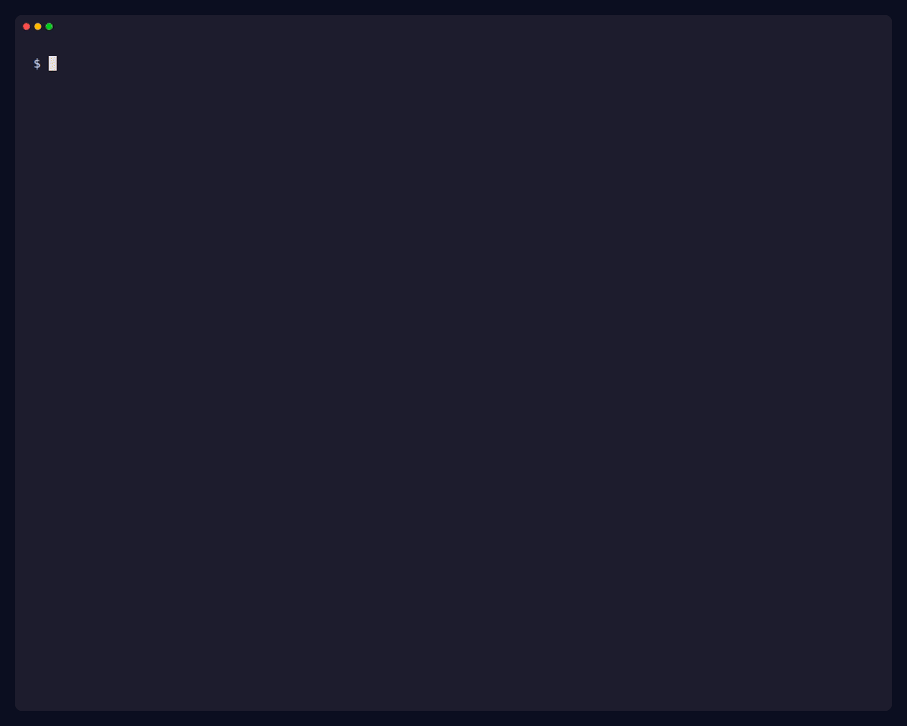

<p align="center">
  
</p>

<h1 align="center">Brixa</h1>

<p align="center">
  CLI interactivo que genera la base de aplicaciones web con React, Vite, Node.js y Express.
</p>

> **Nota:** la versión 0.1.0 no incluye autenticación, RBAC ni multitenancy (ver [Limitaciones](#limitaciones)).



Brixa genera frontend con React y Vite, backend con Node.js y Express, o ambos en un mismo proyecto, en JavaScript o TypeScript y con las capacidades opcionales que elijas.


## Qué genera

Brixa te hace preguntas guiadas y, antes de crear ningún archivo, muestra un resumen de lo que va a generar.

| Modalidad | Qué genera |
|---|---|
| Solo frontend | React + Vite, ESLint, scripts de desarrollo y compilación. |
| Solo backend | Express con una ruta `/health`, validación de configuración con Zod, contrato uniforme de errores, pruebas con Vitest, ESLint, Prettier y `.env.example`. |
| Aplicación completa | Carpetas `frontend/` y `backend/`. En desarrollo, Vite reenvía `/api` al backend mediante un proxy. |

Cada proyecto generado incluye su propio `README.md` con requisitos, instalación, variables de entorno y scripts.

### Capacidades opcionales

Ninguna se añade si no la seleccionas.

| Capacidad | Disponible en | Qué añade |
|---|---|---|
| Persistencia (PostgreSQL o SQLite) | Backend, aplicación completa | Drizzle ORM, un esquema vacío con comentarios guía y los scripts `db:generate` y `db:migrate`. |
| Docker y Docker Compose | Backend, aplicación completa | `Dockerfile` y `compose`. En la aplicación completa, el frontend se sirve con nginx y el puerto del backend no se expone al host. No está disponible para solo frontend. |
| Documentación de API | Backend, aplicación completa | OpenAPI con Swagger UI, **desactivada por defecto**. Se activa con la variable de entorno `ENABLE_API_DOCS`. Queda en `/docs` (backend) o `/api/docs` (aplicación completa). |
| Internacionalización | Frontend, aplicación completa | i18next y react-i18next, inglés y español, detección del idioma del navegador, selector de idioma accesible con la elección guardada en `localStorage` y el script `check:i18n`. |

## Uso

```bash
npx brixa
```

Requiere Node.js 24 o 26 en adelante. Brixa te hace preguntas guiadas y, antes de crear ningún archivo, muestra un resumen de lo que va a generar.
## Combinaciones verificadas

`npm run verify:generated` genera, instala y comprueba **32 variantes** en un directorio temporal. Estas son las que existen hoy:

| Grupo | Variantes |
|---|---|
| Frontend | TypeScript y JavaScript |
| Backend sin base de datos | TypeScript y JavaScript |
| Aplicación completa sin base de datos | TypeScript y JavaScript |
| Con PostgreSQL | Backend y aplicación completa, en TypeScript y JavaScript |
| Con SQLite | Backend y aplicación completa, en TypeScript y JavaScript |
| Con Docker | Backend y aplicación completa, cada uno sin base de datos, con PostgreSQL y con SQLite, en TypeScript y JavaScript (12) |
| Con documentación de API | Backend en TypeScript y en JavaScript (sin base de datos); aplicación completa en TypeScript con PostgreSQL y Docker; aplicación completa en JavaScript con SQLite |
| Con internacionalización | Frontend en TypeScript; aplicación completa en JavaScript con SQLite |

Según la variante, la verificación comprueba:

- Instalación con `npm install` y `npm audit --audit-level=moderate`.
- Compilación, lint, formato (`format:check` en backend) y, en TypeScript, la comprobación de tipos.
- Pruebas del backend con Vitest.
- Que el servidor arranca y responde en `/health`. En la aplicación completa se comprueba también `/api/health` a través del proxy de Vite.
- Con base de datos: generación y aplicación de migraciones con una tabla de prueba que el arnés añade al esquema, y que esa tabla existe.
- Con Docker: `docker compose build` y `up`, servicios en estado *healthy*, respuesta HTTP y que el puerto 3000 del backend no es accesible desde el host (aplicación completa).
- Con documentación de API: que `/docs` devuelve 404 sin `ENABLE_API_DOCS` y que Swagger UI y sus recursos cargan cuando está activada.
- Con internacionalización: coherencia de claves entre idiomas (`check:i18n`), renderizado en servidor en cada idioma, detección y persistencia del idioma, y presencia de las cadenas de ambos idiomas en `dist/`.

El CLI permite cualquier combinación de las capacidades soportadas, pero marca como experimentales en el resumen previo aquellas que no aparecen en esta tabla.

## Limitaciones

- **La versión 0.1.0 no incluye autenticación, RBAC ni multitenancy.** Los proyectos generados no tienen control de acceso: no los despliegues con datos sensibles sin añadirlo.
- **Compatibilidad verificada en GitHub Actions:** Ubuntu, Windows y macOS con Node.js 24 y 26, para las variantes que no requieren Docker ni PostgreSQL. PostgreSQL y Docker solo se verifican en Linux con Node.js 24, mediante un job de CI que se lanza manualmente. El CLI interactivo y la instalación del paquete en un Windows real no se han probado: la CI verifica el generador y los proyectos generados.
- Los proyectos de solo frontend se verifican con compilación y lint, sin arrancar un servidor. En la aplicación completa sí se arranca el servidor de desarrollo de Vite.
- La plantilla de frontend no incluye pruebas.
- No hay pruebas automáticas en un navegador real, incluido el selector de idioma.
- Con base de datos, `npm install` muestra avisos de paquetes obsoletos (`@esbuild-kit`) que vienen de `drizzle-kit`. No afectan al resultado de `npm audit`.
- Con PostgreSQL y Docker, `POSTGRES_PASSWORD` es obligatoria y debe ser alfanumérica.
- La internacionalización admite inglés y español, sin carga diferida de idiomas ni namespaces. El título de la página (`<title>`) no se traduce y el backend no está traducido.
- Fuera del alcance actual: modo avanzado, frameworks distintos de React y Express (por ejemplo Next.js) y otras bases de datos.

## Desarrollo

```bash
npm install
npm run typecheck
npm run lint
npm run format:check
npm test
npm run build
npm run verify:generated
```

`verify:generated` tarda unos 15 minutos y necesita Docker (las variantes con PostgreSQL y Docker usan contenedores desechables). Sin Docker, `VERIFY_SCOPE=portable npm run verify:generated` ejecuta las 15 variantes que no lo necesitan, que es lo que ejecuta la CI en cada sistema. Para ejecutar solo algunas variantes:

```bash
npm run verify:generated -- frontend+ts fullstack+js+sqlite+i18n
```

La documentación de diseño, las decisiones y las tareas del proyecto están en `.agents/rules/`.

## Contribuir

Lee [CONTRIBUTING.md](CONTRIBUTING.md). Las vulnerabilidades se reportan según [SECURITY.md](SECURITY.md), no en issues públicos.

## Licencia

El código de Brixa (el CLI y las plantillas) se distribuye bajo la licencia [AGPL-3.0](LICENSE.md).

**Código generado.** Los proyectos que genera Brixa son tuyos. Puedes usar, modificar, distribuir y licenciar libremente el código generado, incluso con fines comerciales y bajo la licencia que elijas. La AGPL-3.0 se aplica al código de Brixa, no al código que genera. Detalles en [GENERATED_CODE_LICENSE.md](GENERATED_CODE_LICENSE.md).

**Terceros.** Las plantillas de frontend derivan de `create-vite` (MIT). Ver [THIRD_PARTY_NOTICES.md](THIRD_PARTY_NOTICES.md).